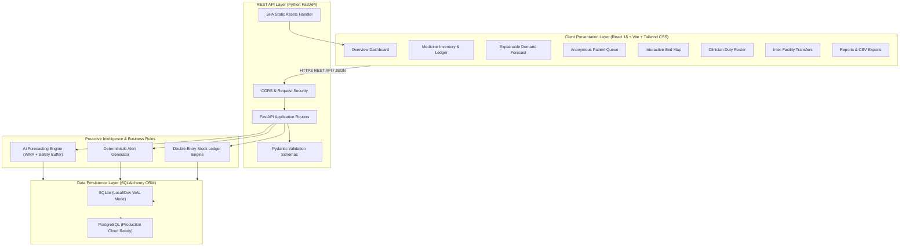
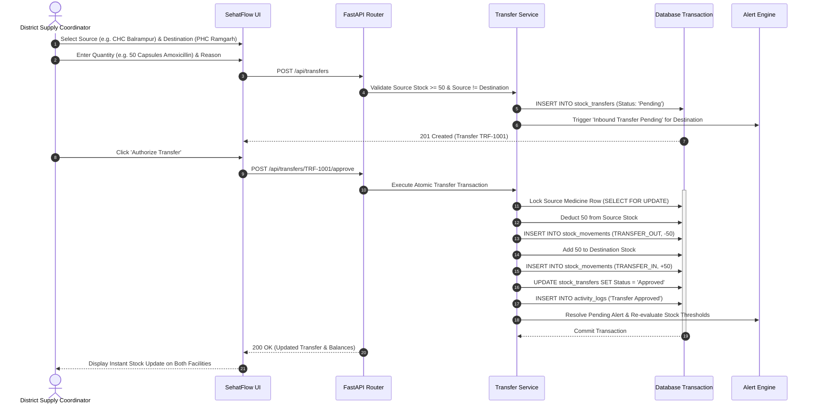
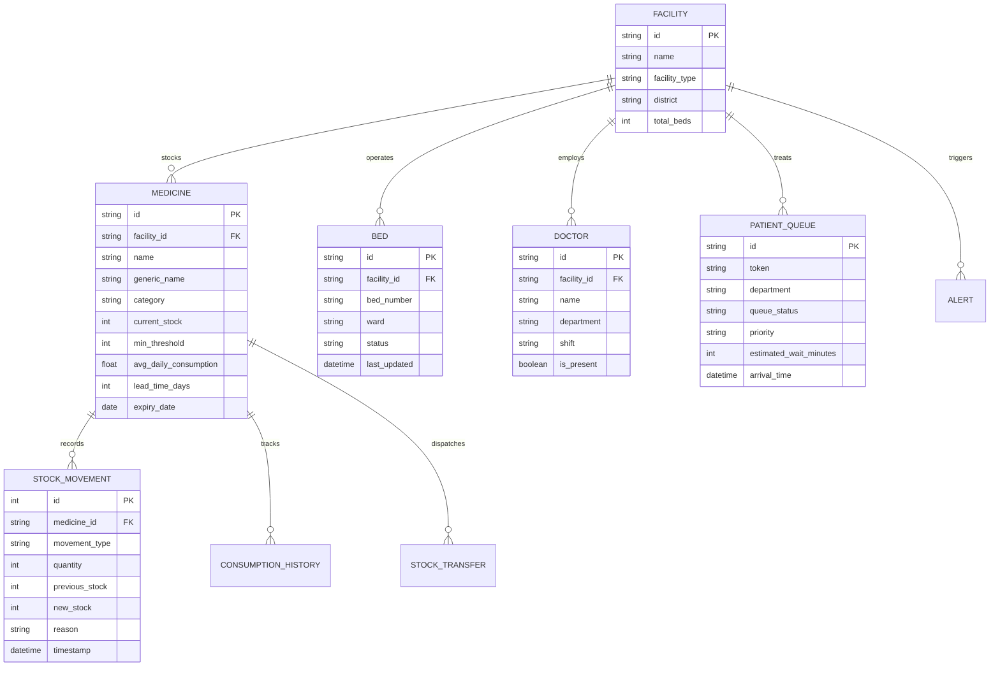

# SehatFlow AI — Technical Architecture & System Design

SehatFlow AI is designed as a modular, responsive healthcare resource intelligence and medicine supply chain management platform. It addresses the critical operational friction experienced by primary, community, and district healthcare facilities.

---

## 1. High-Level System Architecture

---

## 2. Inter-Facility Stock Redistribution Sequence

The inter-facility stock transfer workflow ensures atomic consistency across health centers so medicines cannot be duplicated or lost in transit.

---

## 3. Entity Relationship Diagram

